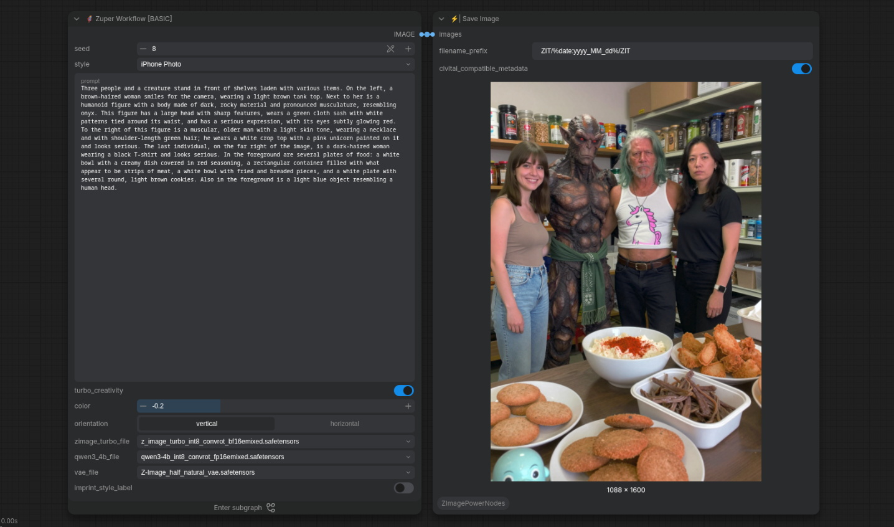

<div align="center">

# Zuper Workflows<br><sub><sup><i>ComfyUI workflows for easily generating high-quality images with Z-Image Turbo.</i></sup></sub>  
<a href="https://github.com/comfy-org/comfyui" target="_blank">
  
</a>
<a href="https://huggingface.co/Tongyi-MAI/Z-Image-Turbo" target="_blank">
  
</a>
<a href="https://creativecommons.org/publicdomain/zero/1.0/" target="_blank">
  
</a>
<a href="https://github.com/martin-rizzo/ZuperWorkflows/commits/master/" target="_blank">
  
</a>
</img>

</div>

**Zuper Workflows** are a collection of workflows designed for [ComfyUI](https://github.com/comfyanonymous/ComfyUI),
leveraging the power of the **Z-Image Turbo** model. They enable you to generate spectacular images with minimal effort,
offering a balance between simplicity and advanced customization.


## 💎 Features

- **Effortless Generation**: Easily create high-quality images with optimized settings and pre-configured styles.
- **Style Customization**: Includes visual styles that leverage each diffusion stage for more original results.
- **Dual Interface Modes**: Choose between a classic node spaghetti layout or the new simplified ComfyUI application mode.
- **Basic & Advanced Variants**: Grouped into `BASIC` workflows for quick results or `ADVANCED` workflows for greater control over the final image.
- **Modular Design**: Final workflows are built from source files for easy updates and rebuilding.


## Requirements

### Software & Custom Nodes

* __[ComfyUI](https://github.com/Comfy-Org/ComfyUI)__ v0.27 or higher, preferably the latest available version.
* __[Z-Image Power Nodes](https://github.com/martin-rizzo/ComfyUI-ZImagePowerNodes)__ v2.1.2 or higher
* __[ComfyUI-GGUF](https://github.com/city96/ComfyUI-GGUF)__ (only if you intend to use GGUF checkpoints)

### Checkpoints

* __diffusion_model:__
  - __[z_image_turbo_int8_convrot_bf16emixed.safetensors](https://huggingface.co/martin-rizzo/Z-Image-Turbo-INT8-ConvRot-ComfyUI/resolve/main/z_image_turbo_int8_convrot_bf16emixed.safetensors)__ [6.17 GB]
* __text_encoder:__
  - __[qwen3-4b_int8_convrot_fp16emixed.safetensors](https://huggingface.co/martin-rizzo/Qwen3-4B-INT8-ConvRot-ComfyUI/resolve/main/qwen3-4b_int8_convrot_fp16emixed.safetensors)__ [4.42 GB]
* __vae:__
  - __[Z-Image_half_natural_vae.safetensors](https://huggingface.co/easygoing0114/Z-Image_clear_vae/resolve/main/Z-Image_half_natural_vae.safetensors)__ [335 MB]

> [!NOTE]
> Although these are the preconfigured checkpoints, any other Z-Image Turbo
> or Qwen3-4b models should work correctly, including GGUF formats if
> [ComfyUI-GGUF](https://github.com/city96/ComfyUI-GGUF) is properly installed.


## Parameter Documentation

* __seed__
  - The initial number for random generation. Each unique seed produces a different image.
  - Results in significantly more dramatic variations when __"turbo_creativity"__ is turned on.
* __style__
  - The visual style that defines the overall look of your final image.
* __prompt__
  - The text description of what you want to see, including subjects, actions, and settings.
  - Avoid style keywords such as photo, comic, or blur, as the selected styles handle all visual effects automatically.
* __steps__
  - The number of iterations performed during the denoising process.
  - The optimal setting is 8 steps. Increase this value only if you require better quality or need to fix minor
    hallucinations caused by `turbo_creativity`, keeping in mind that higher step counts result in longer render times.
* __noise_shift__
  - Adjusts the starting noise to generate small variations in the final image or even correct minor hallucinations.
  - 0.0 is the optimal setting and is generally best left unchanged, as its effects can be unpredictable.
* __turbo_creativity__
  - Shakes up the generation process to produce unique, original compositions and avoid generic AI aesthetics.
  - It is prone to generating hallucinations and duplicate elements, especially in high-contrast images.
  - Disable this feature if you require highly precise and complex images.
  - Enable this feature when exploring creative compositions with substantial variations between different seeds.
  - Working with __turbo_creativity__ involves testing multiple seeds until you find the ideal one.
  - Some minor defects and small hallucinations can be corrected by tweaking __"steps"__ and __"initial_bias"__.
* __contrast__
  - Controls the intensity of brightness transitions in the final image.
  - Typically, a value of 0.2 (positive) works very well.
* __color__
  - Adjusts the color saturation of the image.
  - Generally, a value of 0.2 (positive) yields a colorful image.
  - If the image color appears too intense and artificial, it is advisable to lower it to 0.0 or even -0.2 (negative).
* __hue__
  - Modifies the color tint, primarily used to calibrate skin tones.
  - Typically, a value of -0.2 (negative) works very well.
* __detailed_sampling__
  - Applies a different sampling method in final steps for finer details, although it may increase generation time.
* __orientation__
  - Sets the orientation of the final image, vertical for portrait format and horizontal for landscape.
* __aspect_ratio__
  - Determines the proportional relationship between the width and height of the final image.
* __ck_attention__
  - Enables Comfy-Kitchen attention to accelerate generation.
  - Works best in newer ComfyUI versions and is recommended to stay enabled.
* __zimage_turbo_file__
  - The checkpoint file used for the Z-Image Turbo diffusion model.
* __qwen3_4b_file__
  - The checkpoint file used as the text encoder, which must be based on the Qwen3-4b model.
* __vae_file__
  - The checkpoint file used for the variational autoencoder.


## 📂 Project Structure

```
├── LICENSE                   # License file
├── README.md                 # This file
├── ZuperAPP-advanced.json    # Final generated advanced comfyui-application
├── ZuperAPP-basic.json       # Final generated basic comfyui-application
├── ZuperWF-advanced.json     # Final generated advanced workflow
├── ZuperWF-basic.json        # Final generated basic workflow
├── ZWF-README.txt            # Plain text README included in the final .zip with the workflows
├── src/
│   ├── about.md                        # About section for workflow internal documentation
│   ├── readme-advanced.md              # README content for the ADVANCED workflows
│   ├── readme-basic.md                 # README content for the BASE workflows
│   ├── requirements.md                 # Requirements section for workflow internal documentation
│   ├── STYLES.sty.txt                  # Unified styles file with segments for each diffusion stage
│   ├── zmakefile.txt                   # Build configuration file
│   ├── ZuperAPP-advanced.template.json # Template for building the ADVANCED version of the application
│   ├── ZuperAPP-basic.template.json    # Template for building the BASIC version of the application
│   ├── ZuperWF-advanced.template.json  # Template for building the ADVANCED version of the workflow
│   └── ZuperWF-basic.template.json     # Template for building the BASIC version of the workflow
└── scripts/
    ├── filter_segment.py               # Experimental script used during development
    ├── filter_segment.sh               # Shell wrapper for filter_segment.py
    ├── zmake.py                        # Core workflow generation script
    └── zmake.sh                        # Shell wrapper for zmake.py
```


## 🎨 Internal Style Definitions

The `./src/STYLES.sty.txt` file contains segmented styles for each diffusion stage.
This file serves as the foundation from which the workflows are automatically generated using the `zmake.py` script.

Example segments:
- **Core Styles**: Define the foundational appearance of the image.
- **Layout Styles**: Control the composition and structure.
- **Final Styles**: Refine the overall aesthetic.


## License

This project is licensed under the Creative Commons Zero v1.0 Universal (CC0 1.0)  
See the [LICENSE](LICENSE) file for details.

---

<div align="center">
⭐ If you like what you see, give the repository a star. Your support inspires more explorations!
</div>
